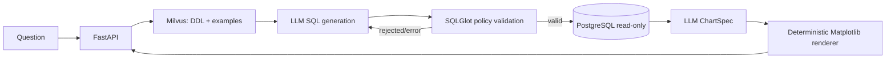

# LLM-Powered Data Analyst Agent

AI-агент для self-service аналитики: принимает вопрос на естественном языке,
находит релевантную схему PostgreSQL и SQL-примеры, генерирует безопасный
read-only запрос, исполняет его и строит график по структурированному описанию.

## Возможности

- LangGraph workflow: retrieval → SQL generation → validation/execution → retry → chart.
- RAG по DDL четырёх таблиц и few-shot SQL-примерам в Milvus.
- До трёх попыток автоматического исправления ошибочного SQL.
- AST-проверка SQL через SQLGlot, whitelist таблиц и принудительный лимит строк.
- Отдельная read-only роль PostgreSQL и server-side `statement_timeout`.
- Безопасная визуализация: LLM возвращает `ChartSpec`, а приложение само строит график.
- FastAPI, API-token authentication, ограниченный CORS и публично безопасные ошибки.
- Воспроизводимый Docker Compose и автоматические тесты в GitHub Actions.

## Архитектура



PostgreSQL содержит синтетические продуктовые данные:

- `users` — страна, тариф и дата регистрации;
- `payments` — платежи и их статусы;
- `app_events` — продуктовые события и платформа;
- `support_tickets` — обращения и оценки поддержки.

## Быстрый запуск

Требуются Docker Compose и ключ OpenRouter.

```bash
cp .env.example .env
```

Укажите в `.env` как минимум:

```env
OPENROUTER_API_KEY=your-key
APP_SECRET_TOKEN=your-long-random-token
```

Запустите инфраструктуру, создайте демонстрационные данные и загрузите RAG:

```bash
docker compose up -d postgres standalone
docker compose run --rm app python -m data.seed_postgres
docker compose run --rm app python -m data.load_data
docker compose up -d app
```

API будет доступен по адресу <http://localhost:8000/docs>. Все сервисы используют
named volumes. Чтобы полностью повторить инициализацию PostgreSQL с нуля:

```bash
docker compose down -v
```

Эта команда удаляет локальные данные контейнеров.

### Локальный запуск API

Инфраструктуру можно оставить в Docker, а FastAPI запустить на хосте:

```bash
python3.11 -m venv .venv
source .venv/bin/activate
pip install -r requirements-dev.txt
python -m data.seed_postgres
python -m data.load_data
uvicorn app.main:app --reload
```

## API

В Swagger нажмите **Authorize** и передайте значение `APP_SECRET_TOKEN`.
Эквивалентный HTTP-запрос:

```bash
curl -X POST http://localhost:8000/api/v1/agent/query \
  -H "Content-Type: application/json" \
  -H "X-Api-Token: your-long-random-token" \
  -d '{"query":"Посчитай ARPU по странам за весь период"}'
```

Сокращённый пример ответа:

```json
{
  "thread_id": "123e4567-e89b-12d3-a456-426614174000",
  "sql_query": "SELECT ... LIMIT 1000",
  "data": [
    {"country": "Germany", "arpu": 112.5}
  ],
  "chart_spec": {
    "chart_type": "bar",
    "x": "country",
    "y": "arpu",
    "group_by": null,
    "title": "ARPU by country",
    "x_label": "Country",
    "y_label": "ARPU"
  },
  "plot_base64": "iVBORw0KGgo...",
  "error": null
}
```

`thread_id` является correlation ID, а не долговременной памятью диалога.

## Модель безопасности

Промпт не считается границей безопасности. Перед исполнением каждый запрос:

1. разбирается SQLGlot как PostgreSQL AST;
2. проверяется как единственный `SELECT`/`WITH` statement;
3. сверяется с whitelist таблиц и схем;
4. проверяется на опасные операции и функции;
5. получает серверный `LIMIT`;
6. выполняется read-only пользователем с `statement_timeout`.

Приложение не исполняет Python-код, сгенерированный LLM. Для графиков модель
возвращает типизированный `ChartSpec`; доступные операции реализованы внутри
`plot_service.py`.

## Тесты

```bash
pytest -q
```

Тесты проверяют SQL policy, блокировку опасных запросов, PNG renderer, retry
маршрутизацию, полноту DDL и API authentication/validation. Workflow
`.github/workflows/ci.yml` запускает тесты и собирает Docker-образ.

## Ограничения и следующие шаги

- Качество Text-to-SQL зависит от выбранной модели и полноты DDL.
- Milvus loader пересоздаёт коллекцию целиком; он рассчитан на bootstrap demo-среды.
- API возвращает base64 PNG; для больших систем лучше использовать object storage.
- Проект пока не хранит историю диалога и не имеет пользовательской авторизации.
- Перед публичным deployment нужны TLS, secret manager, rate limiting, audit logs и eval-набор.

## Стек

- Python 3.11, FastAPI, Pydantic, SQLAlchemy
- LangChain, LangGraph, OpenRouter
- PostgreSQL, Milvus, SQLGlot
- Pandas, Matplotlib
- Docker Compose, Pytest, GitHub Actions
